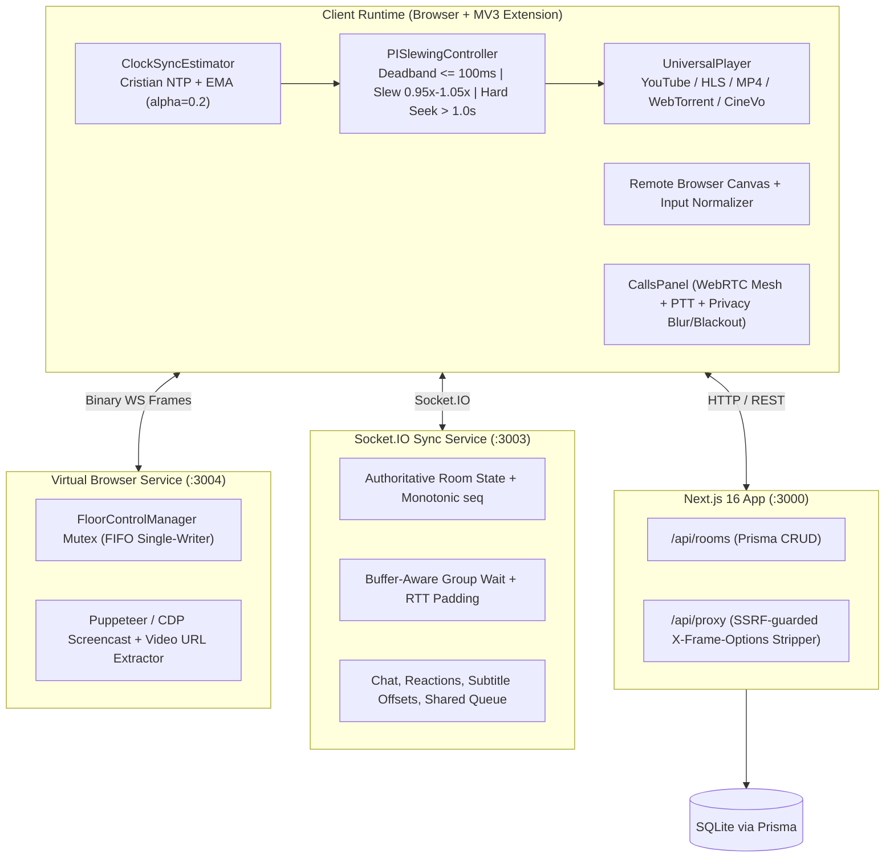

# WatchParty — System Architecture & Technical Due Diligence

## 1. High-Level Topology

WatchParty separates media playback, real-time room synchronization, WebRTC peer communication, and sandboxed virtual browsing into three decoupled services backed by Prisma/SQLite.

## 2. Core Engineering Subsystems

1. **Synchronization Engine (`src/lib/sync/`)**
   - **`ClockSyncEstimator`**: Samples server RTT probes, rejects >500ms jitter outliers, keeps a sliding window of minimum-RTT samples, and applies Exponential Moving Average (`alpha = 0.2`) clock offset correction.
   - **`PISlewingController`**: Deadband zone (`<= 100ms`), bounded PI playback rate adjustment (`[0.95x, 1.05x]`) with anti-windup integral freezing, and automatic hard seek (`> 1.0s`).
   - **Monotonic Sequence Guarding**: Server-stamped timestamps (`lastChangedAt`) + strictly increasing `seq` counters eliminate out-of-order state echoes.

2. **Virtual Browser & Floor Control (`vm-service/`)**
   - **`FloorControlManager`**: Server-enforced single-writer mutex with FIFO request queue and automatic host promotion on disconnect.
   - **CDP Screencast & Extractor (`cdp-browser.ts`, `video-extractor.ts`)**: Captures JPEG frames directly from Chromium DevTools Protocol and extracts `.m3u8`/`.mp4` streams when direct extraction is preferred. Configurable via `CHROME_PATH` and `CHROME_PROFILE_DIR`.

3. **Security & SSRF Protection (`src/app/api/proxy/route.ts`)**
   - Explicit hostname blocklist (`localhost`, loopback, RFC1918 private ranges, link-local metadata), protocol allowlist (`http:` / `https:`), redirect cap (5 hops), and 8 MB payload limit.
