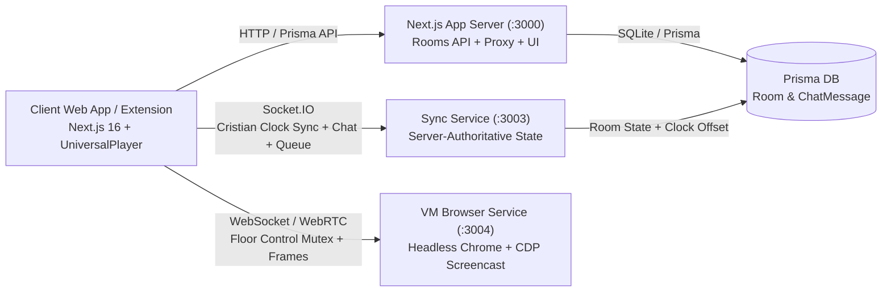

# 🎬 WatchParty

> Watch anything, browse anywhere — together, in perfect sync.

A production-grade watch-party platform that lets you watch videos and browse the web with friends in real-time. Built with Next.js 16, Socket.IO, and Cristian's-algorithm clock synchronization.


---

## ✨ Features

### 🎥 Universal Video Player
- **YouTube** — full IFrame API integration with sync
- **HLS streams** (`.m3u8`) — via hls.js, works on all browsers
- **Direct video** — MP4, WebM, OGG
- **Any website** — iframe proxy with X-Frame-Options stripping
- **Custom controls** — play/pause/seek/volume/fullscreen with sync overlay

### 🖥️ Virtual Browser (VM Mode)
- Real headless Chrome streamed via WebSocket
- Browse **any** site together — Netflix, Disney+, Reddit, anything
- No site can block it (it's a real browser, not an iframe)
- Mouse + keyboard input sent back to the VM in real-time

### ⚡ Real-Time Sync
- **Cristian's algorithm** clock synchronization (~100ms accuracy)
- **Server-authoritative** playback state with monotonic sequence numbers
- **3-tier drift correction**:
  - `≤100ms` → synchronized (no action)
  - `100ms–1500ms` → soft rate adjust (1.05× / 0.95×)
  - `>1500ms` → instant hard seek
- **Echo-loop prevention** via guard flags
- **Seek debounce** (200ms window)
- Periodic heartbeat re-sync

### 💬 Collaboration
- **Chat** with system messages (join/leave notifications)
- **Emoji reactions** with canvas particle physics (🔥 ❤️ 😂 🎉 👍)
- **Queue** — build a playlist, auto-advance, select, remove
- **Presence** — see who's online with colored avatars
- **Host promotion** — automatic when host leaves

### 🎨 Design
- **Porcelain Light** & **Obsidian Dark** themes (Electric Violet accent)
- Responsive — mobile drawer, desktop split panes
- Resizable video/result panels
- Sticky footer, smooth transitions
- No blue/indigo — custom OKLCH color system

---

## 🏗️ Architecture



### Why WebSocket + MJPEG Fallback Alongside WebRTC?
Strict NATs and HTTP tunnels restrict UDP peer connections. WatchParty pairs WebSocket server-authoritative sync (`≤100ms` drift via Cristian's algorithm + PI slewing) with CDP JPEG screencasting over WebSocket and P2P WebRTC voice/video + Screen/Torrent streaming.

---

## 🚀 Quick Start

### Prerequisites
- **Node.js** 18+ and **npm**
- **Bun** (for the sync service) — [install](https://bun.sh)
- **Google Chrome** (for the VM browser feature)

### 1. Clone & Install

```bash
git clone <repository-url>
cd WatchParty
npm install
```

### 2. Set up environment & database

```bash
# Copy environment template and configure values
cp .env.example .env

# Push schema + generate client
npx prisma db push --accept-data-loss
npx prisma generate
```

### 3. Start the sync service

```bash
cd mini-services/sync-service
npm install
bun run dev   # runs on port 3003
```

### 4. (Optional) Start the VM browser service

```bash
cd vm-service
npm install
bun run dev   # runs on port 3004, launches headless Chrome
```

### 5. Start the Next.js app

```bash
# Back in the project root
npm run dev   # runs on port 3000
```

### 6. Open the app

Navigate to `http://localhost:3000`, enter your name, create a room, and share the link!

---

## 🌐 Production Deployment

### Cloudflare Tunnel (recommended)

The app is designed to work behind a Cloudflare Tunnel. Configure three subdomains:

| Subdomain | Port | Service |
|-----------|------|---------|
| `wp.yourdomain.com` | 3000 | Next.js app |
| `sync.yourdomain.com` | 3003 | Socket.IO sync service |
| `vm.yourdomain.com` | 3004 | Virtual browser |

**Cloudflare tunnel config (`config.yml`):**

```yaml
tunnel: your-tunnel-id
credentials-file: /path/to/credentials.json

ingress:
  - hostname: wp.yourdomain.com
    service: http://localhost:3000
  - hostname: sync.yourdomain.com
    service: http://localhost:3003
  - hostname: vm.yourdomain.com
    service: http://localhost:3004
  - service: http_status:404
```

The frontend auto-detects the hostname and connects to the right sync URL.

### Render / Railway / Fly.io

The Next.js app can be deployed to any Node.js host. Set environment variables:

```env
DATABASE_URL=<your-database-url>
NEXT_PUBLIC_SYNC_SERVICE_URL=http://localhost:3003
NEXT_PUBLIC_VM_SERVICE_URL=ws://localhost:3004
CHROME_PATH=/usr/bin/chromium
CHROME_PROFILE_DIR=
```

**Note:** The sync service (port 3003) and VM browser (port 3004) need to be deployed as separate services with their own WebSocket support.

---

## 🛠️ Tech Stack

| Layer | Technology |
|-------|-----------|
| **Framework** | Next.js 16 (App Router, Turbopack) |
| **Language** | TypeScript 5 |
| **Styling** | Tailwind CSS 4 + shadcn/ui |
| **Database** | Prisma ORM + SQLite |
| **Real-time** | Socket.IO 4.8 |
| **Video** | hls.js, YouTube IFrame API |
| **VM Browser** | puppeteer-core + ws |
| **Icons** | Lucide React |
| **Fonts** | Geist Sans + Geist Mono |

---

## 📁 Project Structure

```
WatchParty/
├── src/
│   ├── app/
│   │   ├── api/
│   │   │   ├── rooms/        # Room create/join API
│   │   │   └── proxy/        # iframe proxy (strips X-Frame-Options)
│   │   ├── globals.css       # Theme system (Porcelain + Obsidian)
│   │   ├── layout.tsx        # Root layout
│   │   └── page.tsx          # Landing + Room views
│   ├── components/
│   │   ├── ui/               # shadcn/ui components (47 files)
│   │   └── watchparty/
│   │       ├── universal-player.tsx   # YouTube/HLS/MP4/iframe player
│   │       ├── virtual-browser.tsx     # VM browser embed
│   │       ├── chat-panel.tsx          # Chat with avatars
│   │       ├── queue-panel.tsx         # Video queue
│   │       ├── reaction-rain.tsx       # Emoji particle canvas
│   │       └── participants-list.tsx   # Presence + sync indicator
│   └── lib/
│       ├── sync/
│       │   ├── types.ts              # Shared types
│       │   ├── use-sync-engine.ts    # Socket.IO + clock sync hook
│       │   └── use-video-controller.ts # 3-tier drift correction
│       ├── db.ts                     # Prisma client
│       └── utils.ts                  # cn() helper
├── mini-services/
│   └── sync-service/                 # Socket.IO server (port 3003)
│       ├── index.ts                  # Room state, clock sync, chat
│       └── package.json
├── vm-service/                       # Virtual browser (port 3004)
│   ├── index.ts                      # Puppeteer + WebSocket stream
│   └── package.json
├── prisma/
│   └── schema.prisma                 # Room + ChatMessage models
├── .env                              # Environment variables
└── package.json
```

---

## 🔧 Configuration

### Environment Variables

| Variable | Default | Description |
|----------|---------|-------------|
| `DATABASE_URL` | `file:./data/app.db` | SQLite database path |
| `PORT` | `3000` | Next.js web application port |
| `CORS_ORIGIN` | `*` | Allowed CORS origins (`*` or comma-separated) |
| `PUBLIC_URL` | `http://localhost:3000` | Public application base URL |
| `NEXT_PUBLIC_SYNC_SERVICE_URL` | `http://localhost:3003` | Socket.IO sync service endpoint |
| `NEXT_PUBLIC_VM_SERVICE_URL` | `ws://localhost:3004` | Virtual browser WebSocket endpoint |
| `CHROME_PATH` | Platform default | Path to Chromium/Chrome executable |
| `CHROME_PROFILE_DIR` | System temp `vm-chrome-profile` | Optional Chrome user-data directory |
| `HEADLESS` | `true` | Run Chrome headless inside VM service |

### Sync Engine Tuning

Edit `src/lib/sync/use-video-controller.ts`:

```typescript
// Drift thresholds (in seconds)
if (delta > 1.5) { /* hard seek */ }
else if (delta > 0.1) { /* soft rate adjust */ }

// Soft rate multipliers
const SPEED_UP = 1.05;   // when behind
const SLOW_DOWN = 0.95;  // when ahead

// Heartbeat interval
const HEARTBEAT_MS = 2000;
```

---

## 🧪 How Sync Works

### Cristian's Algorithm (Clock Sync)

```
Client sends { t1: clientTime } to server
Server replies { t1, t2: serverRecvTime, t3: serverSendTime }
Client receives at t4

RTT         = t4 - t1
serverNow   = t3 + RTT/2
clockOffset = serverNow - t4
```

All future timestamps are corrected by `clockOffset`. Re-synced every 30 seconds.

### Server-Authoritative State

```typescript
interface PlaybackState {
  isPlaying: boolean
  currentTime: number      // seconds in video timeline
  playbackRate: number
  videoUrl: string
  lastChangedAt: number    // GLOBAL (server) timestamp
  lastChangedBy: string    // user ID
  seq: number              // monotonic — defeats out-of-order packets
}
```

Clients send **intents** (`state:intent`), the server validates + timestamps + broadcasts (`state:sync`). Late joiners get the current state on `room:join`.

---

## 📝 Commercial Licensing & IP Acquisition

Copyright (c) 2026 Kushal (@onlykushalll). All Rights Reserved.  
Proprietary Commercial Evaluation Asset — see [LICENSE.md](LICENSE.md).

Available for commercial licensing, technical due diligence, and full IP acquisition.  
**Acquisition & Licensing Contact:** `creatormanager27@gmail.com` · GitHub: `https://github.com/onlykushalll`

### Third-Party Open-Source Carve-Out
Upstream frameworks and runtime libraries (Next.js, React, Socket.IO, Prisma, hls.js, noVNC, Puppeteer, Tailwind CSS, Radix UI) remain licensed under their respective open-source licenses. See [ARCHITECTURE.md](ARCHITECTURE.md) for subsystem engineering details.

---

## 🙏 Acknowledgments

- **[WatchParty.me](https://watchparty.me)** — inspiration for the VM browser approach
- **[Syncplay](https://syncplay.pl)** — clean server-authoritative sync protocol
- **[Hyperbeam](https://hyperbeam.com)** — cloud virtual browser API reference
- **[Surfly](https://surfly.com)** — proxy-based co-browsing architecture
- **[Jayant Jain](https://levelup.gitconnected.com/.../acce875fe617)** — best technical writeup on video sync
